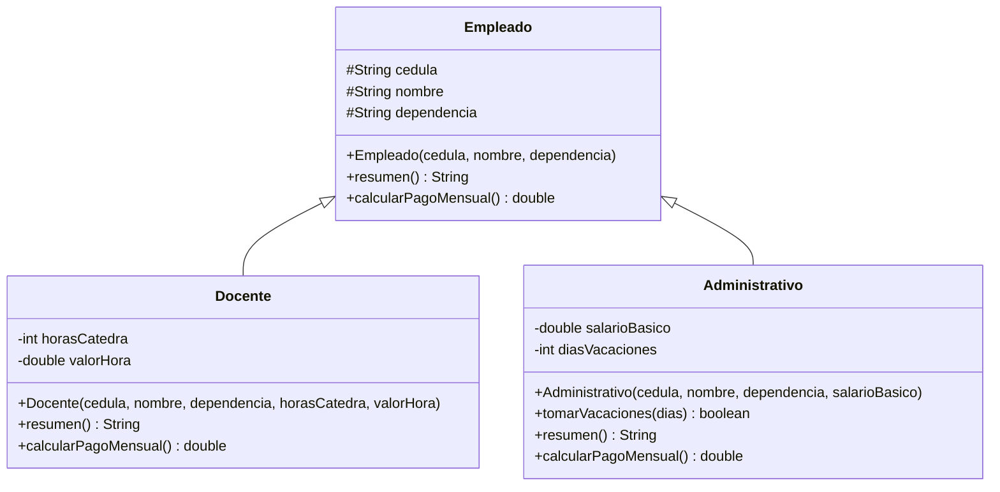

# Taller sesión 4 · Sistema de nómina del INTEP

## Parte B1. Tabla de reparto

| Dato o comportamiento | ¿Dónde va? | Justificación |
|---|---|---|
| cédula | Empleado (clase padre) | Todo empleado la tiene |
| nombre | Empleado (clase padre) | Todo empleado lo tiene |
| dependencia | Empleado (clase padre) | Todo empleado pertenece a una |
| resumen() | Padre y sobrescrito | Existe para todos; cada hija agrega sus datos |
| calcularPagoMensual() | Padre y sobrescrito | Todos se pagan, pero cada tipo lo calcula distinto |
| horasCatedra | Docente | Solo el docente de cátedra lo tiene |
| valorHora | Docente | Solo el docente de cátedra lo tiene |
| salarioBasico | Administrativo | Solo el administrativo tiene salario fijo |
| diasVacaciones | Administrativo | Solo el administrativo tiene vacaciones |
| tomarVacaciones(int) | Administrativo | Comportamiento exclusivo de este tipo |

## Parte B2. Diagrama UML

(Para el `diagrama.png`, pegue este código en https://mermaid.live o dibújelo en draw.io.)

## Parte A. Comprensión de conceptos

**1. Prueba del «es un».** «Un Docente es un Empleado» y «un Administrativo es un Empleado»: ambas tienen sentido. En cambio, «un Empleado es un Docente» no lo tiene, porque no todo empleado dicta clases (el administrativo no). La herencia va de lo específico a lo general, nunca al revés.

**2. `super(cedula, nombre, dependencia);`** Llama al constructor de `Empleado` para que inicialice los atributos heredados. Debe ir en la primera línea porque el objeto padre tiene que existir y quedar construido antes de que la hija agregue lo suyo; Java lo exige y no compila si va después.

**3. `protected` frente a `private`.** Con `private`, `Docente` y `Administrativo` no podrían acceder a `cedula`, `nombre` ni `dependencia` directamente, y `resumen()` de las hijas no podría usarlos. La alternativa que evita `protected` es dejarlos `private` y exponerlos con métodos getter (`getCedula()`, etc.), lo que protege mejor el encapsulamiento.

**4. `@Override`.** Le dice al compilador que ese método debe sobrescribir uno del padre. Si me equivoco al escribir el nombre (por ejemplo `calcularPagoMensul()`) o los parámetros, el compilador marca error en vez de crear en silencio un método nuevo que nunca se ejecutaría en lugar del del padre.

**5. `super.resumen()`.** Reutiliza el texto del padre en vez de duplicarlo. Si mañana cambia el formato de cédula, nombre y dependencia, se modifica en un solo lugar (`Empleado`) y las dos hijas se actualizan solas.

**6. Override y overload.** Sobrescribir es redefinir en la hija un método del padre con la misma firma: `calcularPagoMensual()` en `Docente`. Sobrecargar es tener varios métodos con el mismo nombre y distintos parámetros en una misma clase: por ejemplo `tomarVacaciones(int dias)` y una hipotética `tomarVacaciones(int dias, String motivo)`.

## Datos de prueba
- Docente 60 h × $35.000 = $2.100.000
- Administrativo: $1.800.000
- 15 días − 5 tomados = 10 restantes
